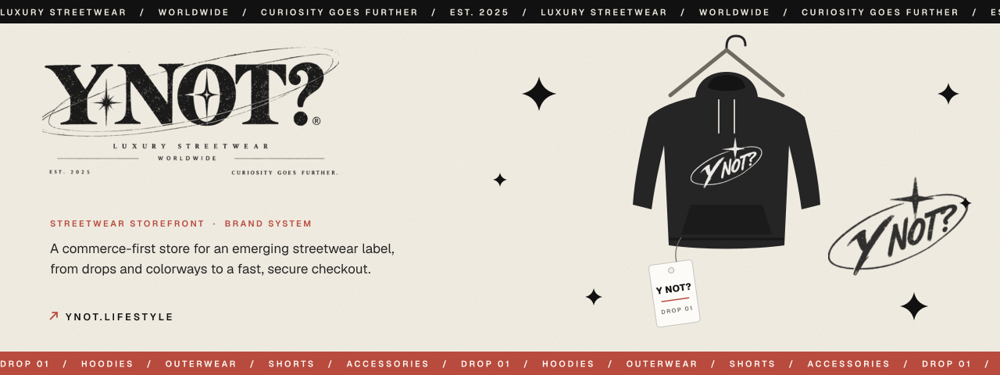
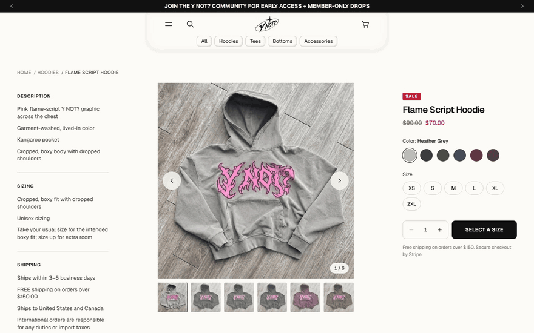
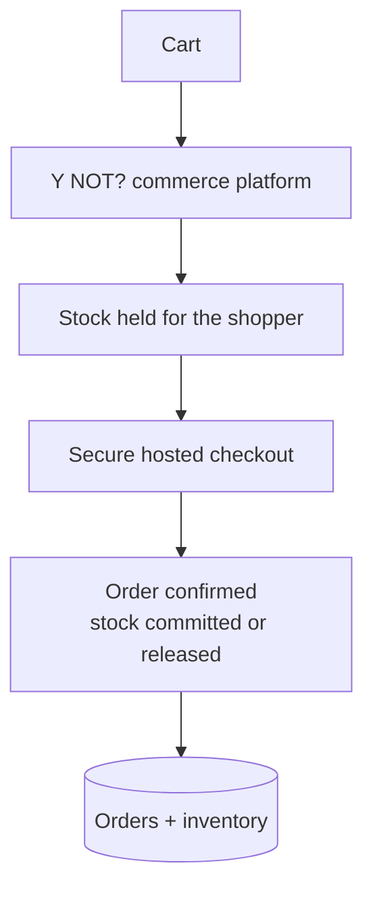
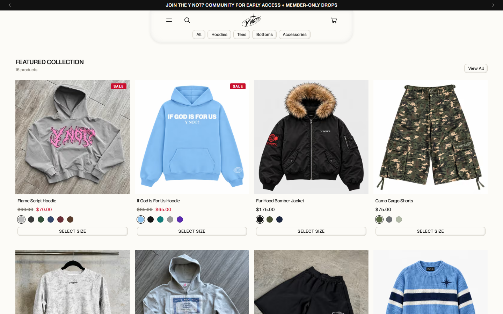
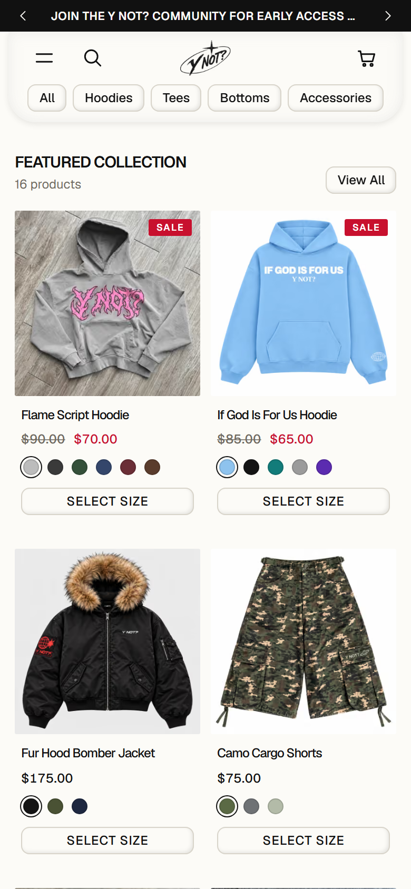
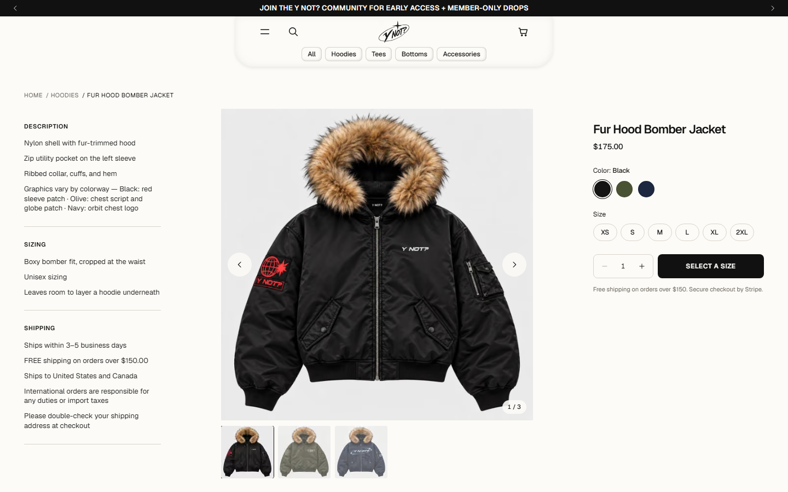

  

<h1 align="center">Y NOT?</h1>

<strong>A commerce-first storefront for Y NOT?, an emerging streetwear label built around one question: why not?</strong>

  &nbsp;
  

Live storefront · Brand system and storefront by Davis Higgins

---

## See it in motion

  

Real capture of the live storefront. <a href="assets/demo.png">Static frame</a>

## What it does

- **Shop by drop and colorway.** Collections, search, and filters lead to product pages where every colorway has its own photography and sizes are chosen per variant.
- **A cart that sells the next step.** A slide-out cart with quantity controls and a free-shipping meter hands off to a secure checkout that supports cards, Apple Pay, Google Pay, and Link.
- **Inventory that can't be oversold.** Stock is held for a shopper during checkout and released automatically if they don't finish.

## What I built

I developed the Y NOT? brand system for the web and designed and built the storefront:

- Brand application: the wordmark lockups, oval mark, star motif, cream-and-ink palette, and image treatment across every page
- Home, collection, product, search, cart, checkout, about, contact, FAQ, and policy pages
- The commerce platform behind it: pricing, payments, orders, and inventory
- Automated production setup, so every deploy arrives ready to sell
- The product photo workflow that turns raw shots into per-colorway galleries

<strong>How it's put together</strong>

 

| Decision | Why |
|---|---|
| **The store sets every price** | Prices, sale prices, and shipping thresholds are always decided by the store, so a modified cart can't change what someone pays. |
| **No two shoppers get the last item** | Stock is held during checkout and settled when payment completes, so inventory stays accurate under pressure. |
| **Built to handle real money safely** | Every order is recorded exactly once, even when payment updates arrive twice or out of order. |

## Screens

<table>
  <tr>
    <td width="62%"></td>
    <td rowspan="2" width="38%" align="center"></td>
  </tr>
  <tr>
    <td></td>
  </tr>
</table>

Featured collection · Product page · Collection on mobile

## Technology

| Layer | Technology |
|---|---|
| Storefront | Next.js, React, TypeScript, Tailwind CSS |
| Payments | Stripe |
| Data | Supabase |
| Motion | GSAP, Motion |
| Hosting | Vercel |

---

  &nbsp;
  

© 2026 Davis Higgins. The Y NOT? name, logos, and product photography belong to Y NOT?.

