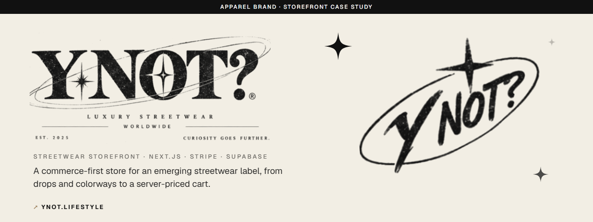
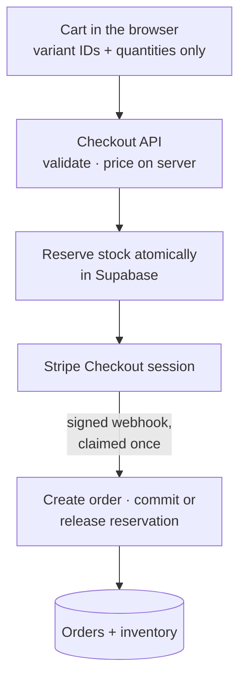

  

<h1 align="center">Y NOT?</h1>

  <strong>A commerce-first storefront for Y NOT?, an emerging streetwear label built around one question: why not?</strong> 
  <a href="https://www.ynot.lifestyle"><strong>Visit ynot.lifestyle ↗</strong></a> · <a href="https://davishiggins.com">Davis Higgins</a>

Live storefront, pre-launch · Checkout runs in Stripe test mode · Brand system and storefront by Davis Higgins

> **Launch status.** The catalog, product pages, cart, and checkout flow are live at ynot.lifestyle. Payments currently run in Stripe **test mode**, so no real orders are being taken yet. Live payments, final size runs, and legal review of the policies are the remaining launch steps.

---

## See it in motion

  

Real capture of the live storefront. It stops at the cart drawer, before checkout. <a href="assets/demo.png">Static frame</a>

## What it does

- **Shop by drop and colorway.** Collections, search, and filters lead to product pages where every colorway carries its own photography, and sizes are chosen per variant.
- **A cart that sells the next step.** A slide-out cart with quantity controls and a free-shipping meter hands off to Stripe Checkout, which supports cards, Apple Pay, Google Pay, and Link.
- **Inventory that can't be oversold.** Checkout reserves stock for every line before payment and releases it if the session expires or fails.

## What I built

I developed the Y NOT? brand system for the web and designed and built the storefront:

- Brand application: the wordmark lockups, oval mark, star motif, cream-and-ink palette, and image treatment across every page
- Home, collection, product, search, cart, checkout result, about, contact, FAQ, and policy pages
- The commerce backend: server-side pricing, Stripe Checkout, signed webhooks, order records, and stock reservations in Supabase
- An automated production setup that applies database migrations, syncs the catalog, and registers the Stripe webhook on each deploy
- The image ingestion script that turns raw product photos into the catalog's per-colorway galleries

## How an order moves

### Engineering decisions

| Decision | Why |
|---|---|
| **The browser stores only IDs and quantities** | The cart keeps variant IDs and quantities and nothing else. Every price, sale price, and shipping threshold is recalculated on the server from the trusted catalog, so a modified cart can't change what someone pays. |
| **Reserve, then commit or release** | Stock is reserved in one database transaction before the customer reaches Stripe. A completed payment converts the reservation into a decrement, and an expired or failed session releases it. Two shoppers can't buy the last item at the same time. |
| **Safety rails before live money** | Live Stripe keys refuse checkout unless orders can be stored, and prices marked provisional are rejected in live mode. Webhook events are claimed by ID, so retried or concurrent deliveries are processed exactly once. |

GSAP loads on demand and smooth scrolling runs only on desktop pointers. `prefers-reduced-motion` turns off smoothing, reveals, and the intro.

## Screens

<table>
  <tr>
    <td width="62%"></td>
    <td rowspan="2" width="38%" align="center"></td>
  </tr>
  <tr>
    <td></td>
  </tr>
</table>

Featured collection · Product page · Collection on mobile

## Technology

| Layer | Technology | Responsibility |
|---|---|---|
| Storefront | Next.js 16 (App Router), React 19, TypeScript, Tailwind CSS 4 | Pages, catalog, search and filters |
| State | Zustand | Persisted cart (IDs and quantities only) |
| Payments | Stripe Checkout and webhooks | Hosted payment, order confirmation |
| Data | Supabase (Postgres, row-level security, transactional functions) | Products, inventory, reservations, orders |
| Validation | zod | Request and catalog validation |
| Motion | GSAP (ScrollSmoother, ScrollTrigger, SplitText), Motion | Intro, reveals, desktop smooth scroll |
| Quality | Vitest, Playwright | Pricing, catalog, webhook, and checkout tests; desktop and mobile flows |
| Hosting | Vercel | Deployment and automated setup |

## Status and limits

- **Not yet taking real orders.** Checkout is wired end to end in Stripe test mode. Activating live payments is an owner step.
- **Pre-launch details.** Size runs and some product details are provisional, and the store's policies await legal review.
- **A separate brand.** Y NOT? has no connection to Lakeside Sport Club, another commerce project of mine with its own identity and storefront.

## About this repository

This is a documentation-only showcase. The storefront's source, product data, and configuration aren't included here.

**[Visit ynot.lifestyle ↗](https://www.ynot.lifestyle)** · Built by [Davis Higgins](https://davishiggins.com) · [More of my work](https://github.com/DavisHiggins)

© 2026 Davis Higgins. Screenshots are shared for portfolio viewing. The Y NOT? name, logos, and product photography belong to Y NOT?. Stripe is a trademark of Stripe, Inc.
